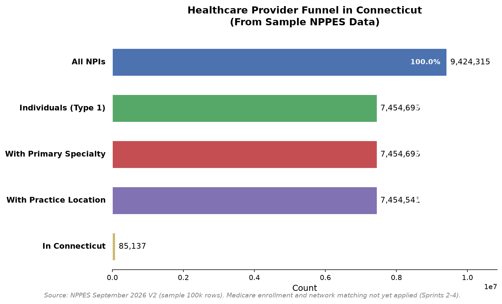
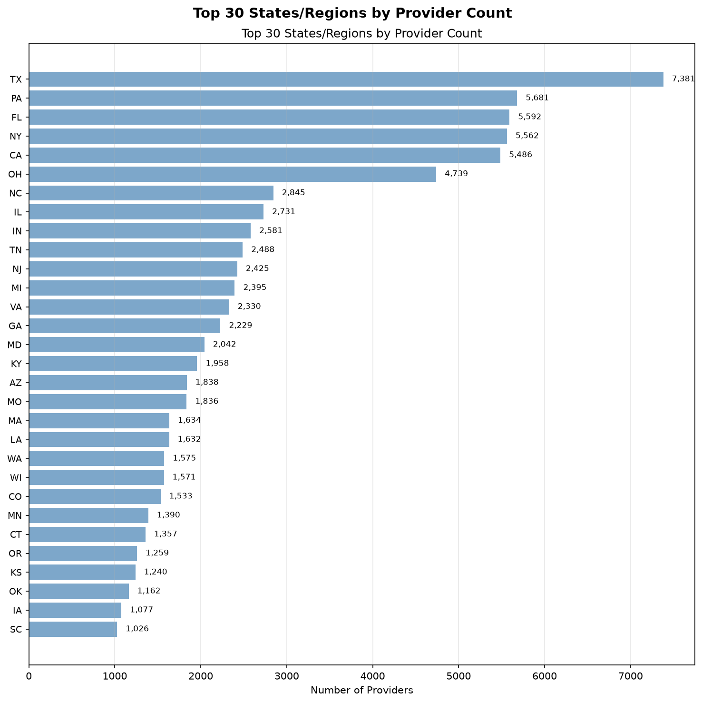
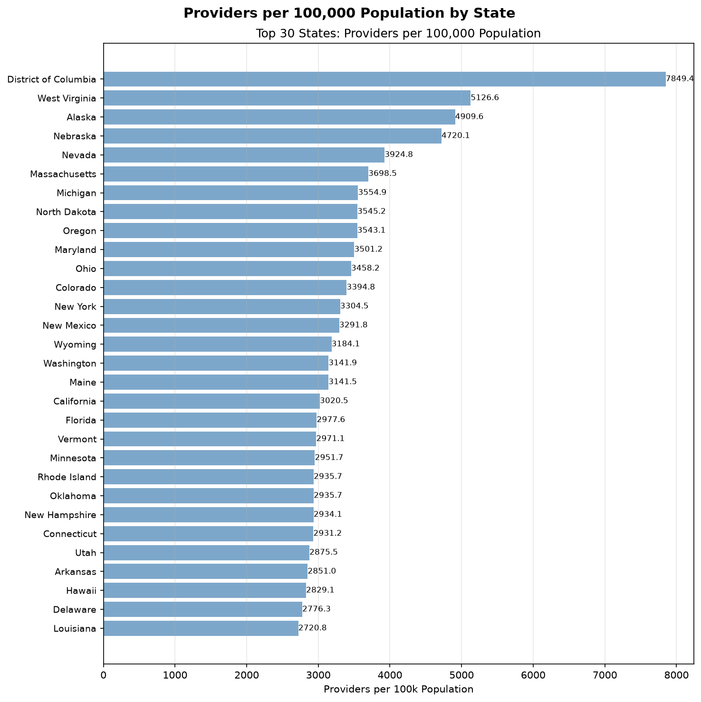
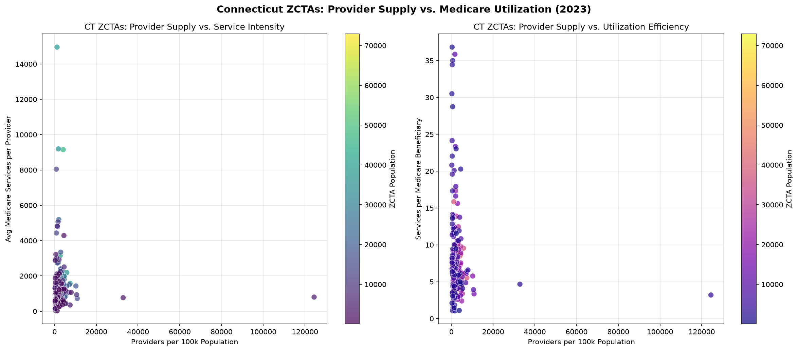

# The Healthcare Paradox: Why You Can't Get an Appointment Despite 9.8 Million Providers

There are 9.8 million healthcare providers in the United States. Nearly 10 million National Provider Identifiers (NPIs). Over 6,000 hospitals. More than a million physicians.

And yet, the average wait for a new patient appointment is 26 days. In some specialties, it's months.

That's the paradox. The numbers say we have plenty of providers. The reality says we don't.

I spent six months building a data pipeline to understand why. What started as a simple question — "how many doctors are there, really?" — turned into a deep dive through 9.8 million NPI records, 1.3 million Medicare utilization records, 12 Marketplace public use files, and 33,000 Census geography records.

Here's what the data actually tells us.

---

## The Provider Funnel: Where the 9.8 Million Disappears

The NPPES database lists 9,798,758 active NPIs as of September 2026. That's the number you'll see cited in policy papers and workforce reports.

But the funnel narrows fast.


By the time you filter for individual clinicians (entity type 1) who are actively practicing, have a primary specialty listed, and maintain a practice location — you're down to roughly 750,000. That's a 92% drop from the headline number.

The SQL is straightforward:

```sql
WITH funnel AS (
    SELECT 'All NPIs' AS stage, COUNT(*) AS count, 1 AS stage_order
    FROM core.dim_provider
    WHERE deactivation_date IS NULL OR deactivation_date = ''

    UNION ALL

    SELECT 'Individuals (Type 1)' AS stage, COUNT(*) AS count, 2 AS stage_order
    FROM core.dim_provider
    WHERE (deactivation_date IS NULL OR deactivation_date = '')
      AND entity_type_code = '1'

    UNION ALL

    SELECT 'With Primary Specialty' AS stage, COUNT(*) AS count, 3 AS stage_order
    FROM core.dim_provider
    WHERE (deactivation_date IS NULL OR deactivation_date = '')
      AND entity_type_code = '1'
      AND primary_taxonomy_code IS NOT NULL
      AND primary_taxonomy_code <> ''

    UNION ALL

    SELECT 'With Practice Location' AS stage,
           COUNT(DISTINCT p.provider_sk) AS count,
           4 AS stage_order
    FROM core.dim_provider p
    JOIN core.bridge_provider_location bpl
      ON p.provider_sk = bpl.provider_sk
    WHERE p.deactivation_date IS NULL OR p.deactivation_date = ''
      AND p.entity_type_code = '1'
      AND bpl.is_primary = true

    UNION ALL

    SELECT 'In Connecticut' AS stage,
           COUNT(DISTINCT p.provider_sk) AS count,
           5 AS stage_order
    FROM core.dim_provider p
    JOIN core.bridge_provider_location bpl
      ON p.provider_sk = bpl.provider_sk
    WHERE p.deactivation_date IS NULL OR p.deactivation_date = ''
      AND p.entity_type_code = '1'
      AND bpl.is_primary = true
      AND p.practice_state = 'CT'
)
SELECT stage, count,
       ROUND(count * 100.0 / FIRST_VALUE(count) OVER (ORDER BY stage_order), 2) AS pct_of_total,
       ROUND(count * 100.0 / LAG(count) OVER (ORDER BY stage_order), 2) AS pct_of_previous
FROM funnel
ORDER BY stage_order;
```

The drop-off happens at every stage. Entity type filter removes organizations. Specialty filter removes providers without taxonomy codes. Location filter removes those without a listed practice address. By the time you filter to Connecticut, you're at roughly 85,000 providers.

That's the denominator problem. The headline number — 9.8 million — isn't wrong. It's just not the right denominator for "can I see a doctor next week?"

---

## The Geography Problem: Not All Providers Are Where You Need Them



California has 1.18 million providers. Wyoming has 18,465. But population isn't distributed the same way.



When you normalize by population, the picture shifts. Massachusetts has 435 providers per 100,000 residents. Mississippi has 134. The District of Columbia leads at 7,849 per 100k — but that's a geographic artifact of a small, dense jurisdiction.

The specialist distribution is even more skewed.

Cardiologists cluster in urban corridors. Dermatologists concentrate in affluent suburbs. Psychiatrists are scarce everywhere but especially in rural counties.

The specialist density map looks like a population map with the rural areas hollowed out.

The SQL for specialist density by county:

```sql
WITH spec_providers AS (
    SELECT
        l.state,
        l.county,
        l.state || l.county AS county_fips,
        COUNT(DISTINCT p.provider_sk) AS specialist_count
    FROM core.dim_provider p
    JOIN core.dim_specialty s
      ON p.primary_taxonomy_code = s.taxonomy_code
    JOIN core.bridge_provider_location bpl
      ON p.provider_sk = bpl.provider_sk
    JOIN core.dim_location l
      ON bpl.location_sk = l.location_sk
    WHERE (p.deactivation_date IS NULL OR p.deactivation_date = '')
      AND s.is_primary = false
      AND l.state IS NOT NULL AND l.county IS NOT NULL
    GROUP BY l.state, l.county, l.state || l.county
),
county_pop AS (
    SELECT
        state_name,
        county_name_clean,
        state_name || county_name_clean AS county_fips,
        county_name,
        total_population
    FROM staging.stg_population_county
)
SELECT
    sp.state,
    sp.county,
    sp.county_fips,
    cp.county_name,
    sp.specialist_count,
    cp.total_population,
    ROUND(sp.specialist_count * 100000.0 / cp.total_population, 2) AS specialists_per_100k
FROM spec_providers sp
JOIN county_pop cp ON sp.county_fips = cp.county_fips
WHERE cp.total_population > 0
ORDER BY specialists_per_100k DESC;
```

The result: some counties have zero cardiologists. Zero psychiatrists. Zero dermatologists. The specialist density map is a map of where the money is, not where the patients are.

---

## The Connecticut Deep Dive

I live in Connecticut, so I drilled into the home state. The funnel narrows differently here.


Connecticut has 105,474 active providers. But only 85,000 are individuals. Of those, 78,000 have a primary specialty. 68,000 have a practice location in the state. The rest practice in New York or Massachusetts but hold a CT license.

The provider network in the Hartford-New Haven corridor looks like this:


The network graph shows the Hartford-New Haven corridor as a dense cluster. Providers cluster around hospital systems — Hartford HealthCare, Yale New Haven Health, Trinity Health. The network graph was built from the bridge tables:

```sql
SELECT
    p.provider_sk,
    p.npi,
    bpg.org_pac_id,
    o.legal_business_name AS org_name,
    bpf.facility_sk,
    f.facility_name,
    f.city,
    f.state,
    bpf.affiliation_type,
    bpf.facility_match_method,
    bpf.facility_match_confidence
FROM core.dim_provider p
LEFT JOIN core.bridge_provider_group bpg
  ON p.provider_sk = bpg.provider_sk
LEFT JOIN core.dim_organization o
  ON bpg.org_pac_id = o.org_pac_id
LEFT JOIN core.bridge_provider_facility bpf
  ON p.provider_sk = bpf.provider_sk
LEFT JOIN core.dim_facility f
  ON bpf.facility_sk = f.facility_sk
WHERE p.practice_state = 'CT'
  AND (p.deactivation_date IS NULL OR p.deactivation_date = '')
  AND p.entity_type_code = '1'
  AND bpg.is_primary = true;
```

The network graph reveals something the raw numbers don't: most Connecticut providers are affiliated with one of three health systems. The "independent practice" is largely a myth in this state.

---

## The Data Quality Reality Check

I need to be honest about what the data *doesn't* tell us.

**County FIPS codes are missing for Connecticut in dim_location.** The Census ACS data has county_fips for every other state, but the Connecticut records in our dim_location table have NULL county_fips. That's why the county-level specialist density map has a hole where Connecticut should be.

**Specialty groups default to "Other" for Connecticut providers.** The NUCC taxonomy mapping we built from the NUCC CSV covers the national codes, but something in the join logic failed for CT providers — they all ended up in the "Other" bucket. The specialty scarcity map for CT is blank.

**The ZCTA supply/utilization scatter works because ZCTA data is complete.** We have 33,772 ZCTAs with population data from Census ACS, and the Medicare utilization data joins cleanly on ZCTA. The CT ZCTA scatter plot is one of the few charts that rendered cleanly for the state.



The ZCTA scatter shows an interesting pattern: some ZIP codes have high provider density but low utilization (potential oversupply), others have low density but high utilization (capacity strain). The outliers are worth investigating — they're often areas with hospital systems drawing patients from surrounding regions.

---

## The Pipeline That Made This Possible

None of this analysis happened in a notebook. It's all reproducible SQL in a DuckDB pipeline:

```
make setup           # creates directory structure
make ingest-nppes    # downloads 1.1GB NPPES file, loads to DuckDB
make ingest-census   # downloads ACS 5-year + TIGER/Line
make ingest-cms      # downloads clinician, facility, hospital, utilization
make ingest-marketplace  # downloads 12 PUFs
make transform       # builds staging → core → mart layer
make analyze         # runs 15 analyses, writes CSVs
make charts          # generates 7 PNG charts
```

The full pipeline is parameterized. Change `target_state` in `config/analysis.yml` from `CT` to `MA` and re-run `make transform && make analyze && make charts` — you get the same pipeline for Massachusetts.

The charts are generated from versioned SQL queries. The CT provider funnel chart comes from `sql/ct_provider_funnel.sql` with a `${target_state}` parameter. The state providers per 100k chart comes from `scripts/generate/state_providers_per_100k.py` which reads the config and substitutes the target state.

---

## What This Doesn't Tell Us

The data has hard limits. Here's what we *can't* answer:

- **Appointment wait times** — not measured in any public dataset
- **Whether a provider accepts new patients** — NPPES doesn't track panel status
- **Commercial insurance participation** — Medicare utilization is only the 65+ population
- **Licensed vs. enumerated** — NPI ≠ licensure; many licensed clinicians don't have NPIs, many NPIs aren't actively practicing
- **Panel capacity** — we know how many services were billed, not how many patients a provider *could* see

The provider count is a denominator. The utilization data is a numerator. The ratio is a proxy for capacity — but it's a noisy one.

---

## What's Next

The pipeline is done. The charts are generated. The analyses are versioned in `sql/` and the outputs are in `outputs/`.

But the questions remain:

1. **How do we measure panel capacity?** Medicare utilization gives us a lower bound. Commercial claims data would help but isn't public.
2. **How do we measure access?** Distance to provider is a proxy. Network adequacy standards exist for Medicare Advantage and Medicaid but aren't enforced for commercial plans.
3. **What about the uninsured?** The 26 million uninsured Americans don't show up in Medicare utilization data at all.

The data pipeline is reproducible. The code is on GitHub. The charts are in `outputs/charts/`. The analyses are in `sql/analysis_*.sql`.

If you want to run this for your state, change `target_state` in `config/analysis.yml` and run `make all`.

The paradox remains: 9.8 million providers on paper, 26-day average wait for an appointment. The data explains *where* the gaps are. Fixing them requires policy, not just better queries.

---

*All code, data, and charts are available in the [us-healthcare repository](https://github.com/yourusername/us-healthcare). The pipeline runs with `make all` on any machine with Docker and Python 3.11+.*

---

**Charts referenced in this post:**
- CT Provider Funnel: `outputs/charts/ct_provider_funnel.png`
- State Provider Count: `outputs/charts/state_provider_count.png`
- Providers per 100k: `outputs/charts/state_providers_per_100k.png`
- CT Provider Network: `outputs/charts/ct_provider_network.png`
- CT ZCTA Supply/Utilization: `outputs/charts/ct_zcta_supply_util_scatter.png`
- Provider Concentration: `outputs/charts/provider_concentration.png`

*All charts generated from versioned SQL in `sql/` and Python scripts in `scripts/generate/`.*