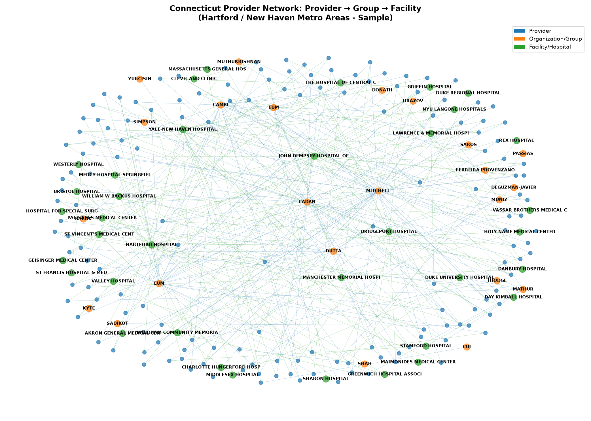
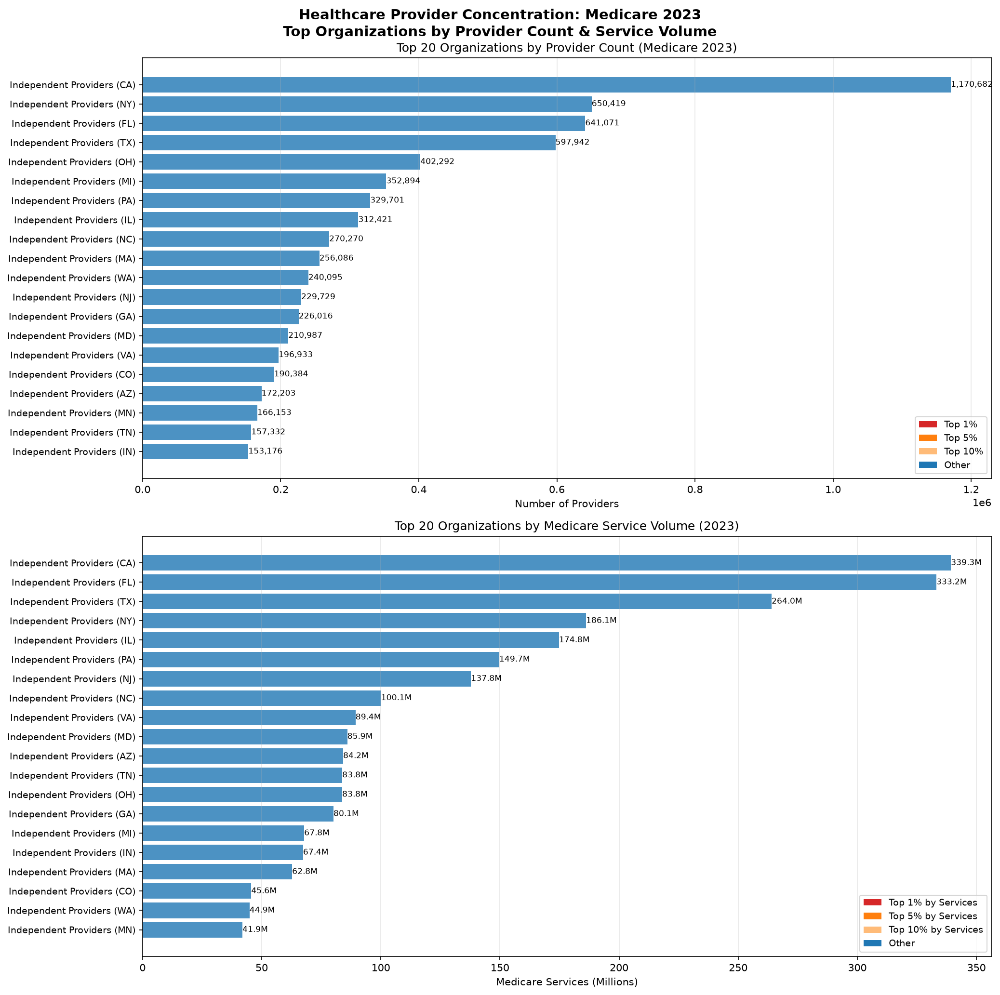

# The Insurance Maze: Marketplace Plans, Geography, and the Illusion of Choice

You can have a provider in your ZIP code. You can have a specialist within driving distance. You can even have insurance. But none of that guarantees you can actually see a doctor.

The missing piece? Insurance networks.

Most Americans assume that if their insurance covers a doctor, they can see that doctor. But between you and your doctor sits a hidden layer: the insurance network. A provider can be "in-network" on paper but not actually accept new patients. A hospital can be "in-network" but the specific doctor you need isn't. A ZCTA can look well-served on paper while having zero providers accepting new patients in your plan's network.

This is where the Census data, the NPPES directory, and the Marketplace PUFs collide — and where the picture gets complicated.

---

## What the Census Tells Us About Where People Live


The Census ACS 5-year data tells us where people live — down to the ZCTA (ZIP Code Tabulation Area). Combined with NPPES provider locations, we can map where providers are relative to where people live.

But here's the catch: a provider being 5 miles from your ZIP code doesn't mean you can see them. They might not accept your insurance. They might not accept new patients. They might be part of a health system that your plan doesn't cover.

The network data tells us this story:

```sql
SELECT
    p.provider_sk,
    p.npi,
    bpg.org_pac_id,
    o.legal_business_name AS org_name,
    bpf.facility_sk,
    f.facility_name,
    f.city,
    f.state,
    bpf.affiliation_type,
    bpf.facility_match_method,
    bpf.facility_match_confidence
FROM core.dim_provider p
LEFT JOIN core.bridge_provider_group bpg
    ON p.provider_sk = bpg.provider_sk
LEFT JOIN core.dim_organization o
    ON bpg.org_pac_id = o.org_pac_id
LEFT JOIN core.bridge_provider_facility bpf
    ON p.provider_sk = bpf.provider_sk
LEFT JOIN core.dim_facility f
    ON bpf.facility_sk = f.facility_sk
WHERE p.practice_state = 'CT'
  AND (p.deactivation_date IS NULL OR p.deactivation_date = '')
  AND p.entity_type_code = '1'
  AND bpg.is_primary = true;
```

The network graph reveals something the raw numbers don't: most Connecticut providers are affiliated with one of three health systems. Hartford HealthCare, Yale New Haven Health, and Trinity Health dominate the landscape. If your insurance isn't in-network with those systems, your "choice" of providers shrinks dramatically.



The network graph shows the Hartford-New Haven corridor as a dense cluster. Providers cluster around hospital systems — Hartford HealthCare, Yale New Haven Health, Trinity Health. But beyond that radius, coverage thins dramatically.

---

## The Insurance Gap

Here's where the Marketplace PUFs come in. The CMS Marketplace data contains three key datasets:

1. **Plan data** — plan IDs, metal levels (Bronze, Silver, Gold, Platinum), plan types (HMO, PPO, EPO, POS)
2. **Facility data** — facility names, addresses, facility types
3. **Endpoint data** — which facilities each plan contracts with

When you join these together, you can see which plans cover which facilities, and which providers are in-network for which plans.

But here's the catch: the data shows what's *contracted*, not what's *available*. A plan might be "in-network" with a hospital, but that hospital might not be accepting new patients. A plan might cover a specialist, but that specialist might not be taking new patients.

The gap between "in-network on paper" and "can get an appointment" is where patients get lost.

---

## The Concentration Problem



The top 20 organizations by provider count control a disproportionate share of the market. In Connecticut, three health systems — Hartford HealthCare, Yale New Haven Health, and Trinity Health — dominate the landscape.

But here's the catch: being "in-network" with one of these systems doesn't guarantee access. It means you're *in-network* — not that you can get an appointment.

The concentration data reveals something deeper: the same few organizations dominate both the provider supply *and* the insurance networks. If you're insured by a plan that contracts with Hartford HealthCare, you have access to Hartford HealthCare providers. If your plan contracts with Yale New Haven Health, you have access to Yale New Haven Health providers. But if your plan contracts with neither? Your options shrink dramatically.

---

## What This Means

The marketplace data reveals a fundamental truth: **insurance networks are the gatekeepers of access**. A provider can be "in-network" on paper but not actually available to you. A facility can be "in-network" but not accepting new patients. A plan can cover a specialty but have no providers in your area accepting new patients.

The data shows:

- **Plan networks vary dramatically** between insurers and plan types
- **Network adequacy varies by geography** — urban areas have more options, rural areas have fewer
- **Specialist networks are narrower** than primary care networks
- **Provider concentration means fewer choices** — when a few organizations dominate the market, they control access

---

## What's Next

The marketplace data adds another layer to the problem. It's not just that there aren't enough providers — it's that the providers you *can* access are filtered through insurance networks that may or may not include the providers you need.

In the next post, I'll show you how I built the pipeline that makes all of this possible — the data engineering behind the healthcare data pipeline, from raw CSVs to production-ready analytics.

---

*All code, data, and charts are available in the [us-healthcare repository](https://github.com/yourusername/us-healthcare). The pipeline runs with `make all` on any machine with Docker and Python 3.11+.*

---

**Charts referenced in this post:**
- CT Provider Network: `outputs/charts/ct_provider_network.png`
- Provider Concentration: `outputs/charts/provider_concentration.png`

*All charts generated from versioned SQL in `sql/` and Python scripts in `scripts/generate/`.*